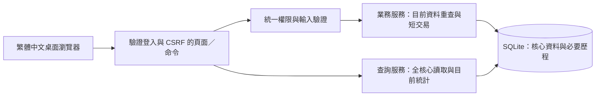
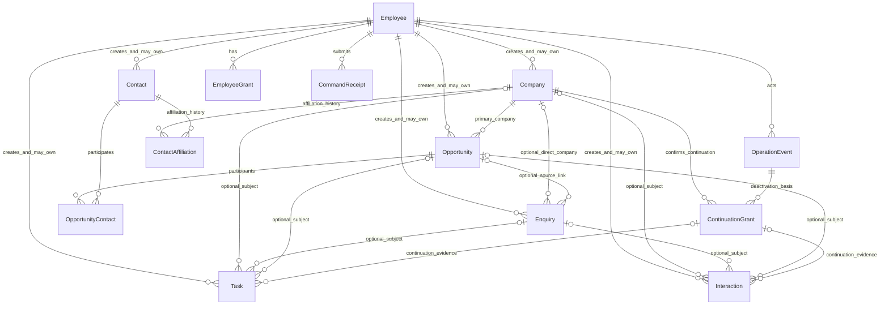

# 04-CRM 第一階段系統設計 v1.0

版本：1.0；日期：2026-11-22（Asia/Taipei）；角色：DEVELOPMENT；狀態：設計交付、待獨立 Review，未實作。

## 1. 輸入與技術決策

業務依據是 [REVIEW 需求 v1.1](04-CRM-REVIEW-PHASE1-REQUIREMENTS-v1.1.md) 的 D01–D12、P01–P03、FR01–FR20 及 AT01–AT22，配合目前 AGENTS.md 與本次 Owner 原始附件。本輪授權為詳細設計，不包含安裝套件、建立資料庫或遷移。功能、畫面、權限與術語校正 T01 見 [功能規格](04-CRM-DEV-PHASE1-FUNCTIONAL-SPEC-v1.0.md)。使用需求確認、方案討論、議價；結果為成交／未成交。

已確認環境：Windows 專案根目錄 `D:\0TIGER\6months\PythonAPIDevelopment\Tiger-NL-TigerInCodex-ERP-V4\04-CRM`，Python 3.14.7、Python 內附 SQLite 3.50.4、Node 可用；FastAPI、Jinja2、Playwright 可匯入，Django 尚未安裝；現有專案只有文件，沒有應用及業務資料庫。這只是可用性檢查，不是套件或應用測試 PASS。

本次技術選擇是 Python＋Django 5.2 維護版本＋伺服端模板＋SQLite。選擇 Django 是因個別帳號、密碼處理、session、CSRF 與表單可共用框架機制，減少自行拼裝安全元件；使用環境既有 FastAPI 亦可行，但需要額外整合這些機制，並非 Owner 必選。Django 5.2 從 5.2.8 支援 Python 3.14；實作時核對並鎖定當時受支援的修補版，不把本文件當套件鎖檔。[官方 Python 相容性](https://docs.djangoproject.com/en/5.2/faq/install/)

SQLite 作單一主機應用的初始本機儲存設計，沒有資料庫伺服器或雲端前提。所有使用者經同一應用存取，不把 DB 放網路共享讓各瀏覽器自行寫入。寫入使用短交易及 `transaction_mode=IMMEDIATE`；不用 `select_for_update()` 冒充 SQLite 資料列鎖。SQLite 寫入競爭能力有限，不能宣稱已有特定人數／吞吐量保證；必要競爭及回滾測試在獲授權實作時執行。若實際部署需要多主機或遇到不可接受競爭，再提出受影響的儲存調整，不能暗中新增業務限制。[官方 SQLite 與交易說明](https://docs.djangoproject.com/en/5.2/ref/databases/#sqlite-notes)

初次本機驗證可使用開發服務；對外或正式多人部署須採正式服務配置並保護傳輸，不能把開發服務當已驗收的正式部署。網路公開、雲端、Docker、付費 API、外部 LLM 均非本期前提，未在本輪執行。

## 2. 應用結構與命令路徑

頁面處理顯示、草稿與錯誤，不負責最終授權。業務服務提供建立／修改、隸屬變更、詢問處理、商機狀態、待辦動作、停用／續辦／轉交、帳號管理。查詢服務不改資料。所有寫入含直接 HTTP 請求、管理入口及後續批次技術程式，都必須經相同服務規則；本期不提供通用 ORM 管理頁修改核心模型。

介面使用 `GET /<類別>/`、`GET /<類別>/<id>/` 及表單頁；變更以 POST 命令執行，不在 GET 寫入。類別為 companies、contacts、enquiries、opportunities、interactions、tasks；employees 限管理權。具體命令依功能規格 OP02–OP19 定義，沒有任意欄位 PATCH 或 DELETE 捷徑。

所有變更輸入封包含 `command_id`（每個已確認草稿固定的不可猜識別）、目標 `expected_version`（建立時無）、白名單欄位；預覽命令另帶工作集合指紋、選項及版本。身份與實際人時永遠由伺服器取得，不接受客戶端冒充 actor/creator。成功後重新導向詳細頁；衝突保留草稿供比較再提交。

## 3. 完整邏輯欄位字典

這是待實作的邏輯結構，沒有建立任何表或 SQL。TEXT 為 Unicode 無任意業務長度上限；ID 採伺服器生成 UUID、不可變，資料庫主鍵唯一。UTC_TIME 是有時區瞬間，DATE 是台北日曆日期，INTEGER 作版本。所有外鍵保護刪除、不設連動刪除。不添加金額／幣別、客戶編碼、附件或預測欄位。

**必填原則：**只強制系統識別／歸責／狀態、已核定必需關聯、明確結果原因及登入安全欄位。不把建議的名稱、電話、統編、需求主旨等偷偷變成 Owner 必填；空白顯示系統識別標籤並可非阻擋提示補資料。業務文字空白可保留，來源未知不用捏造。

### 3.1 共通核心欄位

以下欄位套用 Company、Contact、Enquiry、Opportunity、Interaction、Task。

| 欄位 | 型別／來源 | 必填時點／可改性／約束 |
| --- | --- | --- |
| id | UUID，系統 | 建立時必有，PK 唯一，永不重用 |
| created_by_id | FK Employee，登入人 | 建立時必有、不可改；不是負責人 |
| owner_id | 可空 FK Employee，建立時預填本人 | 可無人負責；後續只由 TRANSFER 改，初始選他人亦查該權 |
| created_at | UTC_TIME，系統 | 建立時必有、不可改 |
| updated_at | UTC_TIME，系統 | 每次成功變更更新，不能代替歷程 |
| version | INTEGER，系統 | 初始 1，每次業務變更遞增；僅接受預期版本相符寫入 |

建立者、負責人可相同也可不同。FK 存穩定帳號 ID，不存可更名登入字串作關聯。沒有聯絡資料的核心紀錄仍能用 ID 與建立人識別。

### 3.2 公司 Company 與聯絡人 Contact

| 實體／欄位 | 型別／來源 | 必填與規則 |
| --- | --- | --- |
| Company.name | TEXT，使用者 | 選填；空白用公司識別標籤，非唯一 |
| Company.phone / email / address / tax_identifier / notes | 各 TEXT，使用者 | 全選填、非唯一，統編不作身分主鍵；無固定客戶碼 |
| Company.is_active | BOOLEAN，系統狀態 | 建立時為啟用；僅停用／啟用命令變更 |
| Company.deactivation_event_id | 可空 FK OperationEvent，系統 | 停用時指向本次停用事件；啟用後清除目前指標，歷史不刪 |
| Contact.name / phone / email / notes | 各 TEXT，使用者 | 選填、非唯一；聯絡人不是個人客戶 |
| ContactAffiliation.id | UUID，系統 | PK |
| ContactAffiliation.contact_id / company_id | FK Contact / Company，使用者選擇 | 建立隸屬時均必有，不能空白一端 |
| ContactAffiliation.started_at / ended_at | UTC_TIME／可空 UTC_TIME，系統 | start 為本次登錄變更時刻；ended 空白代表當期；end≥start |
| ContactAffiliation.created_event_id / ended_event_id | FK OperationEvent／可空 FK，系統 | 連至建立及結束該隸屬的操作 |

同 contact 且 ended_at 為空設條件唯一；同一時刻區間採半開 `[start,end)`，結束舊隸屬與開新隸屬共用同一時刻。先前期間不提供一般表單任意改寫；有資料更正走明確修正服務並保留事件。無「目前公司」重複可編輯欄位，以當期隸屬查得；可清除當期，不插入沒有公司的假隸屬。公司停用不刪聯絡人或隸屬，不把它自動當成離職。

### 3.3 詢問 Enquiry

| 欄位 | 型別／來源 | 必填與規則 |
| --- | --- | --- |
| subject / content / source_note | TEXT，使用者 | 選填；記錄已知內容，不要求先有公司 |
| known_contact_name / known_phone / known_email | 各 TEXT，使用者 | 選填，僅詢問的原始資訊，不自動造 Contact |
| company_id | 可空 FK Company，使用者 | 直接連結，可獨立空白；不由 opportunity 偷補 |
| opportunity_id | 可空 FK Opportunity，使用者 | 可獨立空白，多筆詢問可相同 |
| status | OPEN／CLOSED，系統 | 建立為 OPEN；明確結束為 CLOSED |
| qualification_note | TEXT，使用者 | 選填；資格確認時保留內容，不發明評分或門檻 |
| qualified_at / qualified_by_id | 可空 UTC_TIME／FK Employee，系統 | 首次無；執行資格確認後同時有值，重確認保留歷程 |
| closed_at / closed_by_id / closure_note | 可空 UTC_TIME／FK／TEXT，系統及選填說明 | 結束時前兩必有；說明選填，不新增未核定必填原因 |

兩連結均有時，company_id 必須等於 opportunity.company_id。公司一致性是跨表約束，由所有變更服務在寫鎖交易內驗證。多筆獨立詢問用不同 id；不將同來源文字當唯一。CLOSED 可以更正資料而保留已結束狀態；不藉編輯清掉結束人時。

### 3.4 商機 Opportunity 與參與 OpportunityContact

| 欄位 | 型別／來源 | 必填與規則 |
| --- | --- | --- |
| Opportunity.company_id | FK Company，使用者 | 每筆恰一主要公司，必有；新增時公司必須啟用 |
| title / need_description | TEXT，使用者 | 選填；不是公司層級銷售狀態 |
| stage | 三個穩定代碼，使用者 | 必有；僅需求確認／方案討論／議價，預填需求確認但可另選 |
| status | ACTIVE／HELD／CANCELLED／WON／LOST，命令 | 必有；初始 ACTIVE；對應進行中／暫緩／已取消／成交／未成交 |
| current_outcome_reason | 可空 TEXT，使用者確認 | 目前 WON／LOST 時非空白；重開清空目前值，舊值在事件中 |
| current_outcome_at / current_outcome_by_id | 可空 UTC_TIME／FK，系統 | 與目前 WON／LOST 同時存在；其他目前狀態為空 |
| OpportunityContact.id | UUID，系統 | PK |
| opportunity_id / contact_id | FK Opportunity／Contact，使用者選擇 | 兩端必有；每商機可零至多位，不要求同雇主 |
| added_event_id / removed_event_id | FK OperationEvent／可空 FK，系統 | 保存加入與移除；removed 空白表示目前參與 |

同 opportunity/contact 的目前參與設條件唯一，避免重試多列；過去列保留，可明確移除再加入。stage/status 各有 CHECK；WON／LOST 的 reason/actor/time 一起受條件檢查。沒有另一個可任意輸入的「輸贏」欄位。公司更正查所有直接連結詢問一致性；不相符則拒絕並列需先更正項目，不自動改掛他人詢問。

### 3.5 主題、互動 Interaction 與待辦 Task

主題使用三個可空外鍵 `subject_company_id`、`subject_enquiry_id`、`subject_opportunity_id`；CHECK 非空數≤1。全空是無主題，一個是該主要主題。沒有無 FK 保護的任意 `type/id` 多型主題。公司脈絡沿現有連結衍生，不另存另一主要主題。

| 欄位 | 型別／來源 | 必填與規則 |
| --- | --- | --- |
| Interaction.content / participant_note | TEXT，使用者 | 選填，參與人可文字敘述，不需 R09 橋接或假聯絡人 |
| Interaction.occurred_at | 可空 UTC_TIME，使用者 | 真實發生時間未知可空；輸入台北時間再轉 UTC，不用登錄時間假代 |
| Interaction.fact_confirmed | BOOLEAN，使用者明確確認 | 新增實際互動時為真；不從待辦完成自動設定 |
| Interaction.context_snapshot | JSON，系統 | 建立時必有：當時主題 ID、可知的公司 ID 與顯示文字、來源關係；不是目前可編輯的第二主題 |
| Interaction.continuation_grant_id | 可空 FK ContinuationGrant，選擇後系統核對 | 停用公司續辦所需互動時必有有效依據；不代表 Task↔Interaction 關係 |
| Task.title / description | TEXT，使用者 | 選填，空主旨用識別標籤 |
| Task.scheduled_at | 可空 UTC_TIME，使用者 | 安排時間選填，不自動由建檔時間／固定天數產生 |
| Task.due_on | 可空 DATE，使用者 | 期限選填，依 Asia/Taipei 日曆；無期限不視為今天 |
| Task.status | OPEN／COMPLETED／CANCELLED，命令 | 建立 OPEN，明確動作改狀態，不產生互動 |
| Task.finished_at / finished_by_id | 可空 UTC_TIME／FK，系統 | COMPLETED／CANCELLED 必有，OPEN 為空；重要變化存事件 |
| Task.continuation_grant_id | 可空 FK ContinuationGrant，選擇後系統核對 | 停用公司下新必要待辦須有有效續辦依據，主題仍最多一個 |

互動更正保存原始 snapshot 及前後值於事件，最新顯示明示「已更正」。聯絡人轉職、公司更名、責任轉交不得自動刷新原 snapshot。當前關聯清單與當時脈絡分開顯示，不用過去 snapshot 作目前未完成工作集合。

### 3.6 個別帳號 Employee 與特殊授權 EmployeeGrant

| 欄位 | 型別／來源 | 必填與規則 |
| --- | --- | --- |
| Employee.id | UUID，系統 | PK、不可重用，歷史參照不可刪 |
| login_name | TEXT，授權管理者 | 登入時必有、技術唯一；以明確一致的大小寫／前後空白規則正規化，保留顯示原值；不是客戶資料的唯一性規則 |
| display_name | TEXT，管理者 | 選填，空白顯示 login_name |
| password_hash | 框架安全雜湊，系統 | 帳號啟用前必有；密碼只經框架設定／驗證，不入操作歷程、命令封包存檔或日誌 |
| is_active / version / created_at / updated_at | BOOLEAN／INTEGER／UTC_TIME，系統 | 停用可逆，禁止登入與後續寫入；保留歷史歸責 |
| EmployeeGrant.employee_id / capability | FK／GLOBAL_EDIT、TRANSFER、ACCOUNT_ADMIN | 每 employee/capability 技術唯一；建立撤銷專項查權並記事件 |
| granted_at / granted_by_id | UTC_TIME／可空 FK，系統 | 一般授權必有操作人；首次授權由獲授權初始化留下明確來源，不偽裝為另一位員工 |

不引入部門或角色階層、不以框架 superuser/staff 旗標繞過三項獨立授權。業務歷程所有員工可讀；帳號憑證與授權管理資料不屬全核心公開欄位。正式首次初始化需已有明確操作授權，本輪不建立帳號或填真實員工。

### 3.7 必要技術證據與冪等記錄

| 實體／欄位 | 型別／來源 | 必填與規則 |
| --- | --- | --- |
| OperationEvent.id / command_id / actor_id / happened_at | UUID／UUID／FK Employee／UTC_TIME，系統 | 重要業務變更必有；初始化來源例外明記，不捏造 actor |
| OperationEvent.operation | 固定命令代碼，系統 | 建立、修改、轉職、資格確認、關聯、結束、改階段、暫緩、取消、確認結果、重開、停用、啟用、續辦、轉交、帳號授權等 |
| OperationEvent.target_kind / target_id | 白名單類型／UUID，系統 | 對象存在且 ID 永不重用；技術多型歷程由服務驗證，不接受任意客戶端目標 |
| OperationEvent.before / after / reason | 選定欄位 JSON／可空 TEXT，系統與確認原因 | 保存重要變化；不得含密碼、session、CSRF 或憑證；多對象命令每個目標各有事件並共用 command_id |
| ContinuationGrant.id / company_id / deactivation_event_id | UUID／FK Company／FK OperationEvent，系統 | 綁本次停用識別；公司再啟用再停用後不沿用舊確認 |
| ContinuationGrant.enquiry_id / opportunity_id / task_id | 三個可空 FK，系統 | 恰一非空；是目前已存在且屬該公司之被確認工作，不是第二業務主題 |
| ContinuationGrant.confirmed_by_id / confirmed_at / source_version | FK／UTC_TIME／INTEGER，系統 | 明確確認時必有；更換主題、公司或工作不沿用錯誤來源 |
| CommandReceipt.actor_id / command_id | FK／UUID，系統 | 組合技術唯一，與業務結果同交易提交 |
| CommandReceipt.operation / target_id / request_fingerprint / result_reference / committed_at | 白名單代碼／可空 UUID／雜湊／JSON／UTC_TIME，系統 | 只存允許的非敏感輸入摘要與結果識別；不是原始 HTTP 或密碼存檔 |

ContinuationGrant 是人員確認證據，只有對同公司、本次停用、相符工作脈絡有效，不給新商機權限。現有工作第一次明確確認後可在相同脈絡繼續更新；重要主題／公司變更須重核依據，不可把確認搬到別的工作。停用時未確認項目沒有 grant，但不改其原業務狀態。轉交、啟用、後續停用與確認歷程均保留。

預覽不用另設業務實體或長時間交易：回傳伺服器簽章的 company/target/version、完整工作 ID+version 集合、處理方案摘要。確認時重算比對；簽章不能取代目前資料與權限檢查。

## 4. 關聯逐項白話審視與 ERD

以下 R-ID 沿用正式基線。例子是規則說明，不是預載資料。「可為零」不是要求一定為零；只有核定或技術識別需要的必須關係才強制。

| R-ID／兩端 | 業務意義與例子 | 基數、可選性及理由／證據 | 修改、歷史與反例 | 實際設計映射 |
| --- | --- | --- | --- | --- |
| R01 公司↔聯絡人 | 陳小姐由甲到乙，仍同一人 | 公司0..N人；聯絡人目前0..1公司，跨時間0..N；D03，最多一個不是一定有一個 | 轉職結束舊期間、原往來不搬；兼任兩個當期公司反例不合法；公司停用不等於離職 | ContactAffiliation 兩 FK、期間、當期條件唯一；目前公司衍生 |
| R02 詢問↔公司 | 已辨識來電連到甲公司 | 每詢問0..1直接公司，公司0..N詢問；D04/P03；只連商機亦可 | 不能強迫新增公司；停用不刪詢問；只由商機看到公司不等於直接 FK 已填 | Enquiry.company_id 可空；沿商機公司是衍生 |
| R03 公司↔商機 | 甲公司兩項需求分兩商機 | 每商機1公司、公司0..N商機；D04 | 不可兩主要買方；停用留歷史且不加新商機；更正公司需重核詢問與舊脈絡 | Opportunity.company_id 必填 FK；歷史變化 OperationEvent |
| R04 商機↔聯絡人 | 採購與使用人參與同需求，一人參與多需求 | 兩端0..N；D03未要求必有人、未限雇主相同 | 轉職不自動移除；以雇主強制同公司是反例；明確移除留舊參與 | OpportunityContact 橋接、加入／移除事件與當期條件唯一 |
| R07 待辦↔主要主題 | 商機會議準備或無主題內部整理 | 每待辦0..1，公司／詢問／商機各可0..N待辦；D04 | 多商機會議仍只一主要主題；主題結束不自動完成；停用續辦需證據 | 三個可空 FK＋非空數≤1 CHECK；公司沿主題衍生 |
| R08 互動↔主要主題 | 一次訪談以某商機為脈絡 | 每互動0..1、一主題0..N互動；D04未核定必填主題 | 多人不是多主題；轉職轉交不改當時公司；更正留前後值 | 三可空 FK＋CHECK；context_snapshot 留當時、公司總覽去重 |
| R09 互動↔聯絡人（建議，未採用） | 會議兩窗口或尚未知來電者 | 候選為0..N對0..N；不是 D 決策新增必填 | 不要求虛構聯絡人；參與不證明決策者／雇主；如未來採用須留當時事實 | 本期無參與橋接；選填 participant_note 可記事實，不新增 FK 或必填 |
| R10 員工↔負責紀錄 | 李先生承接所選未完成工作 | 員工0..N紀錄；每紀錄0..1目前負責人是本設計表示選擇，非新增多人責任政策；P01/D07/D09 | 轉交專項確認、不全子項連動；原作者不變，原負責人不保留責任資格 | 六核心 owner_id 可空 FK；變更事件；不以 owner 取代 creator |
| R12 待辦↔實際互動（建議，未採用） | 一待辦需兩通電話，也可能無通話 | 候選兩端0..N，不是核定必備 | 完成不證明通話；無連結亦能用兩功能；不變成第二主題 | 本期不建直接 FK／橋接；同主題僅導覽，不宣稱因果 |
| R14 詢問↔商機 | 兩次詢問連同一既有需求 | 每詢問0..1商機，每商機0..N詢問；D04/P03 | 獨立需求分詢問；直連公司可空，有值須一致；重試不造商機 | Enquiry.opportunity_id 可空 FK；跨表一致性交易檢查 |
| R16 員工↔操作歷程 | 王確認未成交，李後來重開 | 員工0..N事件，每一般業務事件1真實操作人；D09 | 轉交、更名、停用帳號不改舊人；共用帳號不能證明人員 | OperationEvent.actor_id FK 保護、UTC 時刻、目標及前後值 |
| R17 員工↔建立紀錄 | 王建商機、李負責，兩身分不同 | 員工0..N紀錄，每核心1建立者；P01/D09 | 轉交仍保王的 EDIT；竄改 creator 取權不合法 | 六核心 created_by_id 必填不可變 FK；伺服端取得 |

R05、R06、R11、R13、R15 涉報價、問題或業務附件，本期排除，不建立表／端點／驗收依賴，不將 R-ID 改成其他業務意思。

新增的技術支持關聯不挪用以上 R-ID：

| 識別／兩端 | 白話例子、理由與可選性 | 歷史／反例／映射 |
| --- | --- | --- |
| T-R01 員工↔特殊授權 | 李可轉交但不一定可管理帳號；每員工0..3種獨立能力，每能力可給0..N員工；直接源自 P01 三項授權而非任意上限 | 不因全域編輯自動加另兩項；EmployeeGrant 組合唯一，授予撤銷保留事件，不設角色階層 |
| T-R02 公司停用事件↔續辦工作 | 甲停用時明確確認某商機續辦；一次停用0..N確認，一確認1公司及1既有工作；P02及FR18需能重查證據 | 舊停用確認不可搬到另次停用或他公司；ContinuationGrant 三種工作 FK 擇一＋停用事件 FK，確認人FK；不是另一主要主題 |
| T-R03 員工↔命令收據 | 王的同一送出重試只得到原結果；員工0..N收據、每收據1員工；FR18 技術冪等 | 他人不能重用其結果取權；CommandReceipt(employee,command_id)唯一；失敗交易不留成功收據 |
| T-R04 操作↔目標紀錄 | 轉交公司及所選待辦各留下目標事件；一命令1..N事件，每事件1目標；FR14歸責 | 不刪除目標或重用ID；白名單 target_kind/id 在同交易查存在，before/after保存；不是跨業務多主要主題 |
| T-R05 續辦證據↔必要新待辦／互動 | 停用後為已確認商機安排通話；一證據0..N新紀錄，每紀錄0..1證據；P02 | 不能把續辦當啟用或新商機權；Task/Interaction.continuation_grant_id 可空FK，同公司／停用世代及工作脈絡檢查 |

ERD 的 `creates_and_may_own` 線表示必有建立者，owner 是另一條可空 FK，不能由圖誤讀為負責人必填。Task/Interaction 三個主題線必須合併遵守≤1；圖本身未表達 CHECK，不能當成三主題授權。ContinuationGrant 的工作擇一 FK、actor/事件等細節以字典為準。ERD 是設計表示，不是業務批准證據。

## 5. 伺服端不變條件與驗證順序

1. 每請求確認 session 對應的有效員工；寫交易內重讀有效性、當前三項授權及紀錄責任。伺服器只接受本操作白名單欄位；拒絕 creator/actor/直接owner 等保護欄位。
2. CHECK 與 FK 防護：合法 stage/status、公司恰一、主題≤1、隸屬當期唯一、參與當期唯一、結案原因及人時成組、待辦終結人時、合法能力、收據唯一。跨表條件不能靠 SQLite CHECK 子查詢完成，統一服務交易內驗證。
3. 每次 significant write 都查預期版本、FK 存在、目前狀態及操作路徑，不信任舊頁面。沒有權限先回拒絕，不洩漏憑證。
4. 商機新增與主要公司更正均讀目前公司啟用狀態；停用流程與之使用相同交易寫入機制。即使 GLOBAL_EDIT 也拒絕停用目標的新商機關聯。
5. 詢問 company/opportunity 一致性在詢問改連結、商機更正公司兩端均檢查，避免只防一邊。不批次改寫別人的詢問。清除直接公司仍可只留商機，但須該詢問 EDIT 及版本相符。
6. 工作更換主題／公司及停用後續辦同時檢查變更前、後公司脈絡；原工作屬停用公司且未確認時，清除主題本身亦不能先行繞過續辦檢查。引用有效 grant，不能藉隨意填某個 grant 繞過；新脈絡不符既有 grant 時須另行核對，不默默搬移確認證據。無主題不偽裝為某停用公司的工作；畫面及保存內容明確表示上下文。
7. 互動不使用聯絡人當前隸屬重算過往事實；一般編輯關聯亦留舊 snapshot。所有重要變更、確認及授權與資料同交易保存事件。
8. 本期沒有任何核心實體的實體刪除入口；這是未授權刪除功能不實作，不能聲稱 Owner 永久禁止無關聯公司刪除。資料庫 FK 保護既有參照，無 cascade 刪除。帳號停用亦不刪帳號。

## 6. 交易、預覽、冪等與競爭

使用明確短 `transaction.atomic()` 命令邊界及 SQLite IMMEDIATE 寫交易，不以 `ATOMIC_REQUESTS` 包住人員思考、模板輸出或外部動作。所有成功命令依序：取得寫鎖→讀目前身份權限→核對收據／payload→讀目前目標及依賴→版本／業務驗證→寫主資料＋事件＋成功收據→commit。鎖等待逾時回可重試錯誤，不能假裝成功；不要無上限背景重試。

同 actor/command_id、相同 payload 及成功收據回原結果參照；不再次檢查舊 expected_version 而產生假失敗，但仍要求目前有效登入且可讀該結果；帳號管理結果另查目前 ACCOUNT_ADMIN。相同鍵不同 payload／目標／操作回 409，要求新命令。跨員工鍵不共享；新鍵帶舊版本仍被版本檢查擋住。敏感帳號命令不存明文密碼或無金鑰的密碼摘要；完整輸入以伺服器秘密金鑰計算 HMAC 指紋供一致性比較，金鑰與資料庫／收據分開管理且不入日誌。收據標記指紋金鑰版本，舊金鑰無法驗證時拒絕重放並要求讀取目前帳號狀態，不再次執行原命令。如此同鍵換密碼亦回衝突，而不是默默套用或忽略新密碼。

| 邊界 | 同一交易內容 | 競爭、失敗與觀察結果 |
| --- | --- | --- |
| TX01 建立／一般編輯 | 查當前資格及關聯、版本比較更新、事件、收據 | 兩舊版寫入只有先提交者成功；後者409保留草稿，無靜默覆蓋 |
| TX02 轉職 | 查聯絡人 EDIT/version、目前隸屬；結束舊／建新或清除、版本、事件、收據 | 獨立連線同時轉職：第二次因版本拒絕；唯一索引作最後防線，任何故障不能只關舊沒開新 |
| TX03 詢問連結／結束 | 查 EDIT/version、兩 FK、商機目前公司，保存處理事件及收據 | 四組合皆可；矛盾或重試不創公司／商機；商機更正公司同寫入序列防競爭 |
| TX04 商機建立／動作 | 查公司目前狀態、商機 EDIT/version及允許動作；結果原因、參與、前後狀態、事件、收據 | 空原因拒絕；相同鍵返回原結果，不同鍵舊版拒絕；重開同 ID 留舊結果 |
| TX05 停用／續辦／啟用 | 公司 EDIT、目前公司與停用世代、完整工作集合＋版本、簽章及逐項方案；狀態、grant、事件、收據 | 人員確認在交易外；提交前新工作或版本變動409重預覽，不只比公司版本；取消無寫入 |
| TX06 責任轉交 | 重查 TRANSFER、目標與所有選定紀錄版本、完整影響集合、新帳號有效性；只寫選定 owner，事件、收據 | 原負責人舊頁送出在鎖內重新查責任：若先轉交即403／409；原建立者仍可依P01編輯；沒有部分轉交 |
| TX07 帳號／授權 | 重查 ACCOUNT_ADMIN、目標版本／登入唯一性；帳號狀態與獨立能力、事件、非敏感收據 | 撤權／停用與寫入由先提交順序決定；停用後舊session與後續命令拒絕，憑證不入事件 |

受影響未完成工作集合計算：公司 C 的詢問若直接公司=C 或其所連商機公司=C 則納入；商機 primary company=C 且 ACTIVE/HELD 納入；OPEN 待辦主題直接=C 或沿詢問／商機導向 C 納入，沿無關聯詢問則無公司。集合以種類+ID去重，附 version、狀態、owner及關聯來源；預覽簽章含整個集合及處理方案。歷程互動不納入未完成工作。轉交預覽同時列目標與該範圍的未完成工作，不把未選項目偷偷改責任。

停用對新增商機只有兩種序列：新增先 commit，停用重查必須看見新增項而要求重預覽；停用先 commit，新增讀到 inactive而拒絕。只在瀏覽器禁按不能通過此案例。受影響新待辦、改連結及詢問處理也經同一全 DB 寫入序列，預覽與確認間不能漏項。

公司生命週期只有啟用→停用→啟用；已停用時以另一新命令重複停用回狀態衝突，不建立第二次停用世代或清掉已確認續辦。相同命令鍵重送回原收據。已停用公司的後續確認走續辦命令；重新啟用再停用才產生新世代並重做當前工作確認。

故障注入位置至少包括主資料寫入後、歷程／確認證據寫入前及收據寫入前；rollback 後主資料、隸屬、版本、事件、grant、收據均無部分成功。commit 後回應遺失用同命令鍵重新取得結果；不能因前端失敗就重造一筆。這些是後續必驗證設計，未在本輪啟動 DB 證明。

## 7. 登入、安全與錯誤契約

個人帳號用框架 password hash及session，不儲存明文密碼。每次請求讀取有效帳號；登入切換session識別、登出使本次session失效。敏感帳號管理不可混入全部核心查詢。使用模板預設跳脫、ORM參數化、CSRF middleware／表單token；GET無業務副作用。[Django 帳號機制](https://docs.djangoproject.com/en/5.2/topics/auth/default/)；[CSRF 官方說明](https://docs.djangoproject.com/en/5.2/ref/csrf/)

正式部署的秘密設定放環境或受保護設定，不進文件、Git或對話歷程；透過網路存取時配置受保護傳輸與適當cookie，不在本輪更改主機或防火牆。實際部署方式與員工值在後續獲授權設定時給定，設計不需要先發明企業角色或帳號名單。

| 狀態／錯誤代碼 | 伺服端／畫面行為 |
| --- | --- |
| 401 AUTH_REQUIRED | 要求重新登入，妥善保留非敏感草稿；不以舊session繼續寫入 |
| 403 PERMISSION_DENIED | 說明缺一般或專項資格，不改任何業務值；CSRF失敗亦拒絕 |
| 404 RECORD_NOT_FOUND | 目標不存在或無效ID，不自動建立替代紀錄 |
| 422 VALIDATION_ERROR | 原因缺漏、主題多於一、公司矛盾、未知狀態等，在欄位與按鈕附近顯示 |
| 409 VERSION_CONFLICT / PREVIEW_CHANGED / COMMAND_KEY_REUSED | 不覆蓋、不重放不同內容；提供最新值、重預覽或新命令入口 |
| 409 COMPANY_INACTIVE / CONTINUATION_REQUIRED | 顯示停用與續辦規則，無全域編輯繞過，不能默默啟用 |
| 503 WRITE_BUSY | 鎖等待未取得；保留草稿，同命令鍵可重試；無成功宣稱 |
| 500 SAVE_FAILED | 回滾，顯示安全訊息及可查詢參照；診斷留隔離本機日誌，不暴露憑證或原始DB錯誤 |

表單與直接請求用相同業務決策；若以HTML顯示錯誤也保留上述語義與HTTP狀態，不可回成功狀態假裝儲存完成。沒有自動對外通知或背景Owner瀏覽器監控。

## 8. 查詢、索引與持久性

索引服務於查詢／一致性，不是新增業務唯一限制：FK、owner、created_by、status、stage、due_on、affiliation當期與參與橋接；可加正規化公司名稱／聯絡資訊的非唯一索引作警告。company/opportunity連結不做唯一，允許多詢問共用。文字掃描可分頁、不添加固定紀錄上限；不引入外部搜尋服務。

統計從目前主表以ID計數；如需參與或來源條件，使用存在條件或DISTINCT，避免橋接倍增。同一讀取快照回數字與明細篩選，不從OperationEvent累加目前紀錄。UTC瞬間與DATE日期的處理遵功能規格第6節。沒有期限與未完成分開，今日／逾期只是OPEN子集。

Owner資料與QA分開磁碟路徑；應用日常寫入不碰對話歷史。待授權實作時，QA啟動需明確隔離DB路徑，禁止默認落入Owner DB；資料備份使用一致性備份並驗證可恢復，不把活動DB單純當文字複製。本輪未建立DB，故無遷移執行或回滾成果宣稱。

重新載入與真正應用重啟後應保留核心、FK、隸屬／參與歷史、結果事件、grant與收據。正式資料遷移若後續獲授權，先在備份副本檢查值、關聯與回復流程，再按該次Owner授權處理，不從本設計取得遷移真實資料的權限。

## 9. 驗證與後續交付

完整後續案例見功能規格 AT01–AT22；本輪只做文件結構、需求／案例覆蓋、術語、欄位／關聯／狀態／權限／交易的一致性檢查。應用、API、DB、Windows桌面Playwright、重載、重啟、競爭與故障回滾全部 NOT RUN，不能以設計檢查替代。

實作時單元檢查狀態與授權、整合檢查服務交易與FK、獨立連線檢查競爭／重試／故障回滾；Windows桌面檢查每個編輯介面的取消及鄰近錯誤，再用隔離資料重載及實際停止／啟動。只執行受影響且必要的檢查，不把自動檢查交給Owner，不新增手機或壓力測試作門檻。

固定交付識別為這兩份v1.0設計＋需求v1.1＋AGENTS.md術語校正T01；檔案識別及真實檢查記錄列於設計驗證文件。Development作者檢查不等於獨立Review PASS，兩者亦不等於OWNER_VERIFIED。沒有實作／部署／下一階段授權；完成本輪文件與一次對話週期存檔後停止。
