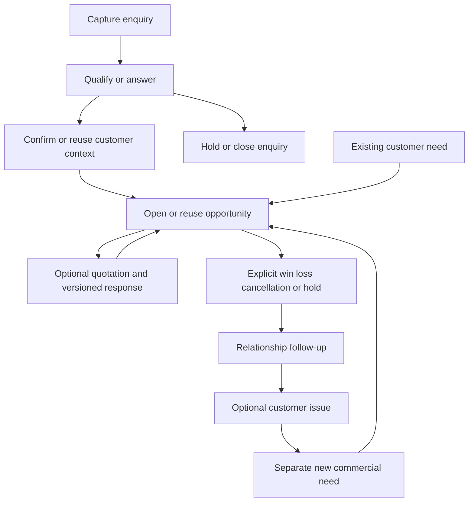

# CRM Functional Proposal for Owner Review

Revision: 0.1. Status: **PROPOSAL / OWNER DECISIONS PENDING**. Author: Review Agent. Audience: Owner, followed by the separate Development Agent after approval.

The proposed CRM helps staff answer five practical questions: Who is the customer? What do they need? What has happened? Who should do what next? What business outcome followed? It covers acquiring, developing, and maintaining customer relationships, with traceable handoffs between people.

The Owner commissioned functional planning, main operations, workflows, design reasoning, and a verifiable handoff. Every module and business rule below is a proposal for that review, rather than an approved product requirement. The shared `AGENTS.md` supplies existing safeguards, including explicit save and cancel, local feedback, data preservation, and separation of proposal, Development verification, independent Review, and Owner acceptance. No previous project's business specification supplies requirements here.

## Functional boundary and participants

The recommended functional core is customer and contact management, enquiry intake, opportunities, interactions and follow-up tasks, a daily workbench, and supporting data administration. Add formal quotations and simple customer issues if the Owner confirms that these activities belong inside this CRM. This combination supports a complete relationship workflow while keeping the boundaries understandable.

An enquiry may concern an unknown party. A customer record may exist without an opportunity. An existing customer may have several unrelated opportunities. A quotation offers terms; it does not establish a completed sale. A staff member's report of a win does not establish accounting revenue.

| Participant | Business responsibility | Handoff |
| --- | --- | --- |
| Customer-facing staff | Maintain customer context, qualify enquiries, pursue opportunities, record interactions, and perform follow-ups | Transfer a named item with its current state and next action |
| Intake or coordination staff, if present | Capture incoming enquiries and direct them to the appropriate responsible person | Hand over the enquiry and original context without rewriting its source |
| Customer service staff, if present | Track customer issues and relationship follow-up | Escalate a commercial need to a new opportunity rather than treating an issue as a sale |
| Manager or Owner | Review workload, pipeline, outcomes, and unresolved business decisions | Confirm priorities and policies; approve the eventual implementation scope |
| Data administrator, if assigned | Maintain allowed choices, accounts, imports, and data quality | Make explicit, reviewable changes without erasing business history |

These are responsibilities, not a prescribed number of departments or permission tiers. One person can perform several responsibilities. The Owner must identify actual users and visibility boundaries under D09.

Automated marketing campaigns, email or telephone integration, electronic signatures, inventory, orders, invoicing, payment collection, and accounting are outside this proposed functional scope. Including any of them would require an explicit scope decision, not an assumed subsequent phase. Manual interaction recording and a clearly labelled external reference can support a handoff to another system without claiming integration.

## Proposed modules and operations

Operation IDs below are references for discussion and verification. They are not a fixed limit on CRM operations.

| Module | Main operations | Practical output and reason |
| --- | --- | --- |
| M01 Customers and contacts | O01 Search, create, and edit customer profiles. O02 Maintain contact people and their business associations. O03 Review suspected duplicates and deactivate or reactivate records under the approved policy. | A customer overview with relevant people, responsibility, open work, and relationship history. Separate people from buying parties so a person changing employer does not rewrite past dealings. |
| M02 Enquiries and qualification | O04 Capture an enquiry and its original source. O05 Assign, qualify, hold for later contact, or close it with an explanation. O06 Link it to existing records or convert it into agreed customer and opportunity work. | An accountable intake queue. Incomplete enquiries remain usable without fabricated customer details. Existing-customer enquiries reuse the existing customer. |
| M03 Opportunities and pipeline | O07 Open an opportunity for a specific need. O08 Update its progress, responsible person, estimate, expected timing, and next action. O09 Record a win, loss, cancellation, hold, or explicit reopening. | A pipeline showing distinct commercial pursuits, their current condition, and what needs attention. A customer's overall relationship does not become a single sales-stage field. |
| M04 Interactions and follow-up | O10 Record an actual call, meeting, message, or visit. O11 Create, schedule, assign, reschedule, complete, or cancel a task. O12 View due, overdue, unassigned, and completed work and record the outcome. | A reliable distinction between planned work and events that actually happened. Staff can resume another person's work without guessing from free-text notes. |
| M05 Quotations if approved | O13 Draft an offer and preview its contents. O14 Issue a specific version and record manual dispatch or response. O15 Revise, supersede, withdraw, or record the customer's reported acceptance or rejection of that version. | A reviewable offer history. An issued version remains interpretable after customer details or commercial terms change. Manual dispatch is labelled as staff-reported, not verified delivery. |
| M06 Customer issues if approved | O16 Open and assign an issue. O17 Record progress, resolve, close, or reopen it. O18 Identify a separate commercial follow-up where appropriate. | A small, accountable after-sales queue. An unresolved service concern remains visible independently of sales success. This does not introduce contractual service levels or a full help-desk product. |
| M07 Daily workbench and reporting | O19 Find records and review a customer overview. O20 Use workload, enquiry, pipeline, and outcome views with filters and drill-through. O21 Inspect inactive, unassigned, or stale work using visible definitions. | Staff see what to do today; managers can trace a number back to the records contributing to it. An unknown value stays visible instead of silently becoming zero. |
| M08 Responsibility and administration | O22 Transfer selected responsibilities with open-work review. O23 Administer user access and approved selectable values. O24 Inspect significant changes and handle record corrections under the approved policy. | Controlled handoffs and consistent vocabulary. Deactivating a staff account does not delete its recorded actions or silently complete its tasks. |
| M09 Data movement and supporting evidence | O25 Preview and validate an import, resolve conflicts, and confirm the selected action. O26 Export the authorized filtered result. O27 Associate, retrieve, or retire supporting files under the approved access and retention rules. | A practical route from existing lists into CRM and from CRM to authorized analysis. A preview prevents bulk operations from becoming silent overwrites. Supporting evidence stays tied to its business context. |

A reusable product or service catalogue is a candidate convenience for M05, not a prerequisite. Drafting descriptive quotation lines avoids creating an inventory or pricing subsystem before a genuine need is established. Rich campaign management and automatic lead scoring are also optional ideas outside the recommended core.

## How staff would use the CRM

The proposed navigation uses plain Traditional Chinese labels: 「今日工作」、「客戶與聯絡人」、「詢問與開發」、「商機」、「互動與待辦」、「報價」and「客戶問題」where approved, plus「查詢與報表」and「管理」for authorized users.

A customer overview shows who the customer is, relevant contacts, the responsible person, open enquiries, opportunities, tasks, and a chronological view of actual interactions. Optional quotation and issue panels appear only when those functions are included. A staff member can open the underlying record from every summary. A shared timeline identifies the kind of record; it never presents a future task as a past interaction.

List pages offer search, relevant filters, sorting, and clear empty states. Record pages show a small set of useful facts first and allow access to history and supporting material. The UI should permit quick capture of an incomplete enquiry, followed by later qualification, rather than forcing staff to enter invented values.

Every editing surface includes 「儲存」and「取消」near the editing controls. Cancel discards the unsaved draft and leaves committed records intact. Validation and operation failures appear beside their triggering controls. An explicit stale-update message lets the user refresh and reconsider an edit instead of overwriting another user's changes. A transfer or retirement preview explains the affected open work before confirmation.

No minimum record count, arbitrary maximum, mandatory telephone number, unique customer name, or default follow-up interval is introduced by this proposal. Required business information is selected at the operation where it becomes necessary, subject to Owner decisions.

## End to end workflows

Tasks and actual interactions support these activities throughout. A quotation is optional, and relationship follow-up can continue regardless of an individual opportunity's outcome.

### W01 Capture an enquiry and qualify it

Intake staff capture what is actually known, the source, the need, and any usable contact route. They search for possible existing records, assign a responsible person or retain the item in a visible unassigned queue, and record the next step. Customer and contact creation can wait until identity is sufficiently understood.

The responsible person qualifies the enquiry. A qualified enquiry can be linked to an existing customer and contact or create genuinely missing ones. If a commercial pursuit exists, staff can reuse an opportunity for that same pursuit or open a distinct opportunity for a new need. Some enquiries need only an answer and can close without an opportunity. Others can remain on hold for a stated reason or close as unsuitable. The original enquiry and its disposition remain accessible.

Conversion is an explicit action with a preview of reused and new records. Retrying the same action must not create another customer or opportunity. Failure must leave a visible, consistent state. A user can also open a customer or opportunity directly; the enquiry path is not a mandatory gate for known business.

### W02 Develop an opportunity and record its outcome

The responsible person opens an opportunity for one specific customer need, reviews the participants, records what is known about value and timing, and chooses a next action. Unknown value or timing is displayed as unknown. The default proposal is one primary buying customer per active opportunity, pending D04.

Illustrative working stages are qualification, needs clarification, proposal, and negotiation. The Owner chooses actual stages and any transition requirements under D05. Staff can move backwards when the facts change. They can hold an opportunity without treating it as lost and cancel an erroneous or abandoned pursuit without classifying it as a competitive loss.

When the outcome becomes known, staff record win or loss, the business explanation, and the approved kind of supporting reference. The application preserves who recorded it and when. Quote acceptance and opportunity win remain separate actions because acceptance may be conditional or cover only part of an offer. A reopening retains the earlier closure history, returns the item to active work, and makes any report consequences explicit.

### W03 Prepare and revise a quotation

If M05 is included, staff draft an offer for a customer, optionally linked to an opportunity. They inspect the recipient, scope, descriptive lines, commercial terms, currency, and a preview before issue. Exact tax, discount, numbering, rounding, validity, and approval rules remain subject to D06; the proposal does not supply guessed financial policy.

Issue preserves the content of that version. A later correction or negotiation produces a new version rather than changing what the earlier recipient saw. Staff explicitly record supersession, withdrawal, or the reported customer response and its referenced version. An older version's response is visible and does not silently accept a different version.

The CRM may provide a printable or downloadable issued offer if approved; sending through email remains a manual action unless separately authorized. Customer name or address changes do not rewrite an issued offer. Issuing or accepting a quotation does not generate an order, invoice, payment, or booked revenue.

### W04 Plan follow-up and record what happened

Staff create a task with a purpose, responsibility, and, when known, a due date or time. Task context points to the relevant customer, enquiry, opportunity, or issue. The workbench makes due and overdue tasks visible and distinguishes tasks without a due date.

Staff complete, reschedule, or cancel the task explicitly. Completion records the task outcome. If an actual customer interaction occurred, staff record that event and can relate it to the task. Internal preparation can complete without any customer interaction; a completed call task must not fabricate a call log.

Actual interactions may be recorded without a preceding task. A new task arising from an interaction remains future work. No automatic reminder cadence, message sending, or default deadline is assumed. Displayed times identify the configured working timezone; a date-only commitment remains a date rather than an invented time.

### W05 Transfer responsibility and retire records

An authorized person selects the customer or work item to transfer, identifies the new responsible person, and reviews relevant open enquiries, opportunities, tasks, and issues. The transfer preview states which responsibilities will change and which will stay with their present owners. Historical interactions retain their original author, time, and business context.

Deactivating a customer, contact association, or staff account preserves existing linked history. The recommended behaviour is to prevent new work that contradicts the inactive status while presenting existing open work for an explicit decision. Deactivation does not silently cancel a quotation or close an opportunity. Exact permitted corrections, deletion, duplicate merging, and reactivation rules are Owner decisions under D07.

### W06 Maintain the relationship after a sale

After recording a win, staff may create an explicit follow-up task for relationship maintenance. A reported customer problem opens a separate issue if M06 is approved. The issue has a responsible person, current condition, next action, actual interactions, and a resolution explanation.

Proposed issue states are open, in progress, waiting, resolved, and closed. A waiting state records what is awaited. Reopening retains the prior resolution. These states do not imply response-time promises or automatic escalation deadlines. If a service conversation reveals a new commercial need, staff open a separate opportunity; neither the issue nor a follow-up task is treated as a sale.

### W07 Import or export business information

An authorized user selects an approved import format, previews how the supplied information will be interpreted, and sees invalid rows and possible duplicates. No live record changes during preview. The user explicitly chooses permitted creates or updates before confirming.

The recommended initial behaviour is an all-or-nothing confirmed batch after validation, with no silent overwrites or automatic duplicate merging. Existing records are rechecked at confirmation. If the Owner prefers partial imports, successful and failed rows and retry behaviour must be separately specified under D10. Export uses the same visible filters and approved data visibility as the on-screen result and makes the selected scope clear.

### W08 Review work and management information

Staff start from the workbench to identify today's commitments and unassigned items. Managers inspect open opportunities, enquiries awaiting action, and unresolved issues where included. Every aggregate opens the contributing records using the same filters.

Reports state what their dates, amounts, and outcomes mean. A current-state view is not labelled as a historical snapshot. A request to reconstruct a past pipeline would require explicit historical-report design after approval.

## Proposed lifecycle meanings

| Business item | Candidate lifecycle | Important distinction |
| --- | --- | --- |
| Customer or contact association | Active, inactive, explicitly reactivated | Relationship status does not erase historical dealings or automatically close related work. |
| Enquiry | New, being qualified, on hold, linked or converted, closed | Conversion preserves the source and does not imply a sale. Closing without an opportunity is valid. |
| Opportunity | Open with an approved stage; optionally on hold; won, lost, or cancelled; explicitly reopened | Open stage, temporary hold, and terminal outcome have different report meanings. Exact stages and evidence depend on D05. |
| Task | Open, completed, cancelled; due or overdue is a derived view | Changing the due date does not prove an interaction happened. An undated task is neither automatically due nor overdue. |
| Interaction | Recorded actual event, with an explicit correction history where corrected | An interaction records an occurrence; it is not a task status or a forecast. |
| Quotation if included | Draft; issued version; explicitly superseded or withdrawn; recorded response to a specific version | Document version, validity, and reported response are distinct conditions. Expiry meaning requires D06. |
| Customer issue if included | Open, in progress, waiting, resolved, closed; explicitly reopened | A resolution is distinct from a sales outcome and preserves its prior explanation. |

These are functional meanings to review, not database enumerations or an approved transition matrix.

## Information concepts and business relationships

At this level the main concepts are the buying customer, a contact person, an enquiry, an opportunity, an actual interaction, a planned task, an internal responsible user, and, where approved, a quotation and a customer issue. Supporting documents provide context. A quotation version preserves a communicated offer rather than creating another opportunity.

Customer identity, record responsibility, and business progress remain separate concepts. The design does not require customer names, telephone numbers, or email addresses to be unique identifiers. Stable internal identity is an implementation necessity; customer-visible codes and uniqueness policies require later business agreement.

The following relationship review is deliberately in Traditional Chinese, as required by `AGENTS.md`. Every R-ID describes a candidate business relationship. The cardinalities and examples are recommendations to review, not Owner-approved restrictions. Database fields, FK definitions, bridge tables, physical types, and ERD are deferred under the Owner's instruction to focus on functional design first. Each relationship will receive its actual storage mapping only in a subsequently authorized design task.

| 關聯 | 業務意義與例子 | 候選基數與可選性及理由 | 編輯與歷史影響及待確認事項 |
| --- | --- | --- | --- |
| R01 客戶與聯絡人 | 客戶是交易或服務對象；聯絡人是可聯繫的人。例如陳小姐曾代表甲公司，後來改代表乙公司。 | 建議在時間範圍內允許多對多，雙方均可暫無關聯；同一人可能兼任數家公司的顧問，不能把一人一公司當成通則。 | 更換任職或代表關係不得搬移舊互動。個人客戶是否另外建立聯絡人須由 D01、D03 決定。此例為設計假設，不是 Owner 已確認的組織規則。 |
| R02 詢問與客戶 | 詢問可在身分未明時先受理，確認後再連至客戶。例如收到新來電後才確認是既有客戶。 | 建議每筆詢問可暫無或有一個主要客戶；一個客戶可有零至多筆詢問。這避免用假客戶填補未知資料。 | 後續確認或更正連結須保留原始來源。集團多公司共同詢問是反例，需 D04 決定拆分或額外參與關係；目前不自動合併。 |
| R03 客戶與商機 | 商機描述某一客戶的一項具體購買需求。例如甲公司同時洽談顧問服務與維護方案。 | 建議一客戶可有零至多個商機；啟動追蹤的商機有一個主要客戶。未確認買方的需求先保留為詢問。 | 客戶停用不刪除商機。客戶歸屬更正須明確記錄；聯合採購是反例，主要買方或多方模式待 D04 決定。 |
| R04 商機與聯絡人 | 聯絡人可參與需求說明、決策或協調。例如同一商機涉及採購及使用部門窗口。 | 建議多對多且均可暫無；一人可參與數個商機，商機初期也可能尚未確認窗口。 | 聯絡人離職不移除舊參與紀錄；外部顧問不必是客戶員工。角色與必備窗口由 D03、D05 確認。 |
| R05 商機與報價 | 報價可回應某個商機，也可直接提供給既有客戶。例如同一商機比較兩種方案。 | 若納入報價，建議一商機可有零至多份報價，每份報價可無或連至一個商機；版本不另外計為商機。 | 接受某版本不自動將商機成交。跨商機共用同份報價是反例，如何處理待 D06 決定；目前建議保持單一業務脈絡。 |
| R06 客戶與報價 | 正式發出的報價有明確接收對象。例如已發給甲公司的報價保留當時公司名稱。 | 若納入報價，建議一客戶可有零至多份報價；草稿可待確認，正式發出時須有一個主要收件客戶。 | 客戶資料更新不得改寫已發出內容；多買方或多人共同承諾的情形待 D01、D06 確認。 |
| R07 待辦與業務主題 | 待辦為某筆詢問、客戶、商機或問題安排下一步。例如為一個商機準備會議資料。 | 建議一待辦可有零或一個主要業務主題；一主題可有零至多個待辦。無主題可支援一般內部準備工作。 | 主題停用或結案不默默完成待辦。跨多商機的一次共同工作是反例，建議指定主要主題並保留說明，是否需多重連結待 D04。這不是對資料庫欄位形式的指定。 |
| R08 互動與業務主題 | 實際通話或會議以主要脈絡保存。例如為甲公司某商機舉行需求訪談。 | 建議一互動有一個主要詢問、客戶、商機或問題脈絡；一主題可有零至多筆互動。未知客戶的互動可先連詢問。 | 客戶總覽可沿業務關聯顯示同一互動，但不複製或重複計數。跨客戶會議是反例，需 D04 確認是否支援多重主題。 |
| R09 互動與聯絡人 | 互動記錄實際參與者。例如同一會議有採購及技術人員。 | 建議多對多且均可暫無；匿名來電可以先保留已知事實，不虛構聯絡人。 | 參與者轉職後仍保留當次脈絡。參與互動不自動等於正式決策者或客戶員工；D03 確認相關規則。 |
| R10 負責人與待處理業務 | 內部人員負責客戶、詢問、商機、待辦或問題。例如王先生離職，由李小姐承接指定工作。 | 建議一人可負責零至多筆業務，各筆有零或一位主要負責人；未指派項目須明顯顯示。實際必須指派的時點待 D09。 | 轉交不改寫舊互動作者；停用帳號不刪除紀錄。多人共同負責是反例，是否需協作名單及責任分工由 D09 決定。 |
| R11 客戶與問題 | 客戶問題追蹤已知對象的服務需求。例如甲公司回報使用疑問，另開問題追蹤。 | 若納入問題，建議一客戶可有零至多個問題，每個正式問題有一主要客戶；身分未明先進詢問受理。 | 問題可重開，客戶停用不刪除問題；非既有客戶也直接開問題的需求待 D08 確認。 |
| R12 待辦與互動 | 待辦是計畫，互動是事實。例如一次跟進待辦可能經兩次通話才完成，也可能只是整理內部資料而無互動。 | 建議一待辦可連零至多筆實際互動，一互動可無或連一個起因待辦；兩者都能獨立存在。 | 完成待辦不自動建立互動。一次會議同時完成數項待辦是反例，建議先選主要起因並分別記錄完成結果；多重連結待 D04。 |
| R13 業務紀錄與支持文件 | 文件支持其業務脈絡。例如報價版本附上相關需求說明。 | 建議一紀錄可有零至多份文件，每份附件有一個主要歸屬；相同文件跨紀錄引用的需求由 D12 決定。 | 移除顯示或停用紀錄不應破壞需保留的已發報價及歷史證據；讀取權限隨業務脈絡檢查。檔案保留、共用及清除規則待 D12，未假定法定期限。 |
| R14 詢問與商機 | 詢問可導向新的商機，也可補充既有商機。例如同一採購需求先後由兩位窗口來詢問，兩筆詢問連至同一商機。 | 建議每筆詢問可無或連一個主要商機，一商機可有零至多筆來源詢問；直接建立的商機不必虛構詢問。 | 連結或轉換後仍保存原詢問。一次詢問涵蓋多項獨立採購是反例，拆成多商機或允許多重連結由 D04 決定；不得因重試而重複開商機。 |
| R15 報價與版本 | 版本保存某份報價在特定次數的內容。例如同一報價協商後第二版改了服務範圍，第一版仍可查閱。 | 若納入報價，一份報價可保留多個版本，每一版本只屬於一份報價；草稿可以尚無已發出版本。這保留協商過程而不增加商機數量。 | 已發內容不得被新版覆寫。獨立替代方案究竟是另一份報價或同份報價的新版，須由 D06 決定，不能一律當成追加銷售。 |

## Reporting definitions and data safeguards

| View | Proposed meaning | What makes it verifiable |
| --- | --- | --- |
| Today's work | Open tasks due on the selected working date, overdue open tasks, unassigned items, and an explicit undated queue | Drill-through preserves date, timezone, responsibility, and status filters. Completed and cancelled tasks do not remain overdue. |
| Enquiry queue | Enquiries by current disposition, source, and responsibility; conversion traced to its resulting records | A converted enquiry can be opened and followed to the correct customer and opportunity without duplicate conversion. |
| Open pipeline | Unique open opportunities, grouped by approved stage and currency, with held work visibly separate | Amounts come from opportunity estimates, not a sum of all alternative quotations. Unknown amounts have their own count. Different currencies are not silently added. |
| Won and lost outcomes | Current terminal outcomes filtered by their latest applicable closure date; cancelled, held, and currently reopened items are excluded from the win-rate denominator | Proposed win rate is won divided by won plus lost within that scope; an empty denominator displays no result. Reopened items move out of this current-outcome report. Past published snapshots require separate approval. |
| Issued offers if included | Quotations and responses to identified versions, with superseded and withdrawn offers distinguishable | Multiple revisions cannot inflate opportunity counts or be summed as completed sales. Quote totals need D06 financial rules before implementation. |
| Relationship follow-up | Open work and most recent recorded actual interaction, with any stale threshold visible and selected | Lack of a recorded interaction is labelled as such. No invented inactivity deadline or automatic customer-loss classification. |
| Customer issues if included | Current issues by condition and responsibility, with explicit resolution and reopening history | No implied service-level breach or response-time commitment without an approved policy. |

Financial forecasts, weighted pipeline, cross-currency conversion, historical pipeline reconstruction, and revenue reporting are not implied by these operational views. D11 determines whether they are needed and supplies their business definitions before implementation.

Shared safeguards apply to affected operations: validate important writes against current authoritative state; prevent duplicate confirmations; detect conflicting edits; preserve related identities and historical context; make partial failures explicit; and keep imports, QA records, and Owner data separate. Evidence access and exports follow approved visibility. These are functional protection requirements, not a prescribed database technology or an event-sourcing architecture.

## Consolidated Owner decisions

All decisions below remain **PENDING**. The Owner may approve the recommendations, choose alternatives, or exclude a candidate capability. An undecided optional capability can be excluded from the initial approved scope; it need not block unrelated approved work. A decision becomes a development requirement only when the Owner confirms it.

| Decision | Recommended choice | Alternative and consequence | Affected scope |
| --- | --- | --- | --- |
| D01 Buying party types | Permit organizations and individual customers, with an appropriate customer overview for each | Organizations only simplifies initial forms but excludes consumer clients; individuals only would exclude company buying relationships | M01; R01, R03, R06 |
| D02 Included functional scope | Approve M01–M04 and M07–M09 as the functional core; explicitly choose whether M05 quotations and M06 customer issues are included | Excluding quotations keeps offers in another process; excluding issues keeps after-sales handling outside CRM. Neither exclusion prevents customer follow-up tasks | All modules and optional acceptance scenarios |
| D03 Contact and participation semantics | Allow optional contacts, time-aware representation of more than one customer, and several participants per opportunity or interaction | One current employer or mandatory contact simplifies screens but misrepresents consultants, unknown callers, or early-stage enquiries | M01, M03, M04; R01, R04, R09 |
| D04 Business context and conversion | One primary customer per active opportunity, at most one primary subject per task or interaction with internal tasks allowed to be unlinked, optional enquiry conversion, and reuse of confirmed existing records including the same pursuit's opportunity | Joint buying groups, several primary subjects, or several opportunities from one conversion require explicit allocation and duplicate-counting rules | W01–W04; R02, R03, R07, R08, R12, R14 |
| D05 Opportunity progress and outcome evidence | Approve a short set of stages fitted to the actual sales process, reversible progress, explicit hold and cancellation, and a recorded explanation or reference for terminal outcomes | A compulsory linear process or automatic outcome from quote acceptance is simpler to automate but can misstate business. Owner must define what qualifies as a win and what evidence is necessary | M03; W02; outcome views |
| D06 Quotation policy if included | Preserve issued versions, permit a direct customer quotation or an opportunity link, and record response to an identified version | Requiring an opportunity adds a compulsory step. Approval chains, alternative-offer versus revision semantics, multi-party offers, tax, discounts, currency choices, rounding, numbering, printable content, and expiry behaviour need actual business decisions | M05; W03; R05, R06, R15 |
| D07 Correction and retirement | Warn about possible duplicates without automatic merging; prefer deactivation for referenced records; require explicit review of affected work during transfer or retirement | Hard deletion or merging can be supported only after the Owner defines eligible records, link handling, history preservation, and recovery. Legitimate same-name records must remain possible | M01, M08; W05 |
| D08 Customer issue boundary if included | Use a simple issue queue for known customers, with manual assignment, next action, resolution, and reopening | Keep all service work outside CRM, or separately specify anonymous issue intake, warranties, contractual response times, and escalation if genuinely needed | M06; W06; R11 |
| D09 Users and access | Identify actual users, permitted record visibility, who may change assignments or settings, and who may export; authenticate any shared deployment | A single-operator tool has simpler access needs. Own-record-only or team-restricted access needs explicit exceptions for handoffs, shared contacts, reports, and evidence | All user-facing modules; R10 |
| D10 Import and external communication | Approved import preview with explicit create/update choices and an all-or-nothing confirmed batch; authorized filtered export; manual interaction recording | Partial import needs row-level outcomes and safe retries. Live email, calendar, telephone, or external-system integration requires a separate authorized requirement | M04, M09; W07 |
| D11 Measures and working time | Use operational counts and currency-separated estimates, a named working timezone, and the explicit current-outcome definitions above | Weighted forecasts, conversion rates with cohort rules, FX conversion, historical snapshots, and booked-revenue measures require additional authoritative definitions and inputs | M07; W08 |
| D12 Supporting files and reminders | Keep necessary evidence with access tied to its business context; use on-screen due-work reminders; agree permitted file use and retention before implementation | References without stored files reduce local file handling but depend on external availability. Shared-file reuse, automatic reminders, and retention deadlines require explicit rules | M04, M09; R13 |

## Acceptance scenarios for later verification

These scenarios define observable behaviour if the relevant choices are approved. They are a verification plan, not claims that an application exists or that application tests have passed. Development must convert the approved subset into meaningful implementation checks; Review must examine its delivered baseline independently.

| Scenario | Setup and action | Expected observable outcome | Coverage |
| --- | --- | --- | --- |
| AC01 Customer identity and participation | Create two legitimate same-name customers; associate a contact who represents both | Names do not silently merge records. The person's associations and the two customers' histories remain distinguishable, subject to D01 and D03 | M01; O01–O03; R01 |
| AC02 Unknown enquiry and later reuse | Capture an incomplete enquiry, then identify an existing customer and convert it once; retry the same confirmation; link a second enquiry about the same pursuit | No invented customer details are required. The same existing customer and relevant opportunity are reused, with each original enquiry accessible and no duplicate conversion result | M02; O04–O06; W01; R02, R14 |
| AC03 Distinct commercial pursuits | Open two opportunities for one customer and update one | Separate progress, estimates, and next actions remain visible; changing one does not change the other | M03; O07–O08; W02; R03, R04 |
| AC04 Closure and reopening | Under D05, record a loss, reopen it, then record a win with the required explanation | Earlier outcomes remain traceable. Current pipeline and outcome reports reflect the current state without counting the opportunity twice | M03, M07; O09, O20; W02, W08 |
| AC05 Planned work versus actual event | Complete an internal task without contacting a customer, then record a real call independently | Completion does not create a fictitious interaction. The actual call and its time appear as an event, while planned work remains identifiable | M04; O10–O12; W04; R07–R09, R12 |
| AC06 Due and overdue work | Schedule, reschedule, complete, and cancel representative dated tasks; also create an undated task | Views use the selected working date and timezone. Only open dated tasks can be overdue; the undated item remains visible in its own queue | M04, M07; O11–O12, O19–O21; W04, W08 |
| AC07 Offer version integrity if included | Issue an offer, change customer details, revise the offer, and record a response to the old version | Issued contents remain unchanged. The response references the actual version. No sales outcome, order, or revenue is silently generated | M05; O13–O15; W03; R05, R06, R15 |
| AC08 Commercial calculation if included | Once D06 is approved, preview representative line totals, tax or discount cases where applicable, and issue the version | Preview and issued content follow exactly the approved calculation and rounding rules; unrelated currency totals are not combined | M05, M07; O13–O15, O20; W03 |
| AC09 Issue resolution if included | Open, assign, resolve, close, and reopen an issue; identify a separate buying need | Issue history survives reopening. The buying need becomes distinct opportunity work, with no automatic sale or invented service deadline | M06; O16–O18; W06; R11 |
| AC10 Responsibility and retirement | Transfer selected open work, deactivate a former staff account or contact association, and inspect past interactions | Only the selected responsibilities change. Historical authors and context remain. Remaining unassigned or incompatible open work is visible | M01, M08; O03, O22–O24; W05; R01, R10 |
| AC11 Cancel and local failure feedback | Edit each included type of form, cancel, then trigger a relevant validation or save failure | Cancel preserves committed data. Failed edits remain understandable, with feedback beside their controls and no false success state | Included editing operations; W01–W07 |
| AC12 Conflicting and duplicate actions | Have two users edit the same work item and retry a significant confirmation; safely reproduce a failure | Conflicting edits do not silently overwrite each other. Retries do not duplicate effects. Failed actions leave a consistent, reported state | M02–M06, M08–M09 as included; O06, O09, O14, O22, O25 |
| AC13 Import safety | Preview a sample with invalid rows and possible duplicates, then change a target record before confirmation | Preview changes no business record. Confirmation revalidates. The approved batch policy, conflict choices, and retry behaviour are explicit and preserved | M09; O25; W07 |
| AC14 Access and export | Use each approved access category to search, open a record, read evidence, view reports, export, and attempt a disallowed action | The approved visibility applies consistently. Export uses the selected filtered scope and cannot reveal records excluded by that policy | M07–M09; O19–O20, O23, O26–O27; W07–W08 |
| AC15 Traceable report totals | Use open, held, cancelled, closed, and reopened opportunities; unknown amounts; alternative quote versions; and different currencies | Each displayed aggregate drills to its contributing records. Counts and amounts follow the written definitions without duplicate offers, unknown-to-zero conversion, or mixed-currency sums | M07; O20–O21; W08 |
| AC16 Evidence retrieval and persistence | Save representative approved records and supporting files, reload, and restart the implemented application in isolated QA | Committed records, links, and accessible evidence survive. A record's access policy still governs its supporting files | M01–M09 as included; O27; R13 |
| AC17 Approved choices and correction trace | Change an approved selectable value or correct a significant business record using an authorized account | Existing business meaning and references remain interpretable; significant changes can be attributed. A configuration change does not silently close or reclassify work | M08; O23–O24; W05 |

## Owner approval and Development handoff

The Owner reviews D01–D12 together, identifies actual business exceptions, and confirms the included modules and selected acceptance scenarios. Any approved deviation is recorded alongside the relevant decision, rather than silently editing a proposal into an accepted requirement. Pending financial, lifecycle, identity, or permission rules must not become guessed application behaviour.

After scope approval, the separate Development Agent should first produce a traceable functional specification with approved operation rules, screen flows, exception handling, report meanings, and a detailed acceptance matrix. Detailed entities, field requiredness and types, uniqueness, relationship storage, ERD, transition rules, and technical architecture then belong to an explicitly authorized design step. Implementation requires the Owner's explicit authorization; approving this proposal does not itself authorize code or database creation.

The Development handoff should identify the approved proposal revision and decisions, changed-file inventory, exact delivered analysis or source version, verification evidence, and known limitations. This proposal supplies stable discussion references, not a code-review verdict. Because Review authored it, checks of its own proposal are consistency checks; they must not be represented as independent validation of the proposal. Subsequent Review can examine the separate Development deliverable against the approved requirements, and Owner acceptance remains a distinct decision.
